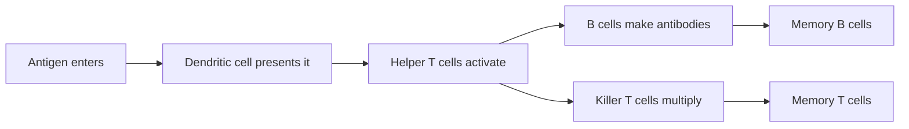

# How Vaccines Train the Immune System

By the end of this guide you'll understand how a vaccine teaches your body to recognise a pathogen it has never met, why some vaccines need boosters, and what herd immunity really means.

## 1. The Two Arms of Immunity

Your immune system has two layers that work at very different speeds. The first responds within minutes but is generic; the second takes days to get going but is precise and, crucially, remembers.

- **Innate immunity**: the fast, non-specific first line of defence — skin, mucus, inflammation and cells that attack anything that looks foreign.
- **Adaptive immunity**: the slower, highly specific defence that learns the exact shape of a particular invader and keeps a memory of it for years.
- **Antigen**: any molecule, usually a protein on the surface of a virus or bacterium, that the adaptive immune system can recognise and target.

Think of innate immunity as a building's security guards who stop anyone suspicious, and adaptive immunity as detectives who study one specific intruder's face and circulate the photo. The guards act immediately; the detectives take a while, but once the photo is out, that intruder is caught on sight.

A vaccine works entirely through the adaptive arm. It shows the immune system an antigen — without the disease — so the "photo" is already circulating before the real pathogen ever arrives.

> [!IMPORTANT]
> A vaccine doesn't fight infection itself. It rehearses the adaptive immune system so the real response is faster and stronger.

## 2. From First Exposure to Memory

When the adaptive system meets a new antigen, a sequence of events unfolds over one to two weeks.

- **Antibody**: a Y-shaped protein made by B cells that binds tightly to one antigen, neutralising it or tagging it for destruction.
- **Memory cell**: a long-lived B or T cell that survives after an infection clears and can restart a full response within hours if the antigen returns.

The first response is slow because only a handful of cells initially match the antigen; they must multiply into an army. The second time, the memory cells are already numerous and primed. This is why the antibody level after a second exposure can be *ten to a hundred times* higher than after the first.

We can describe the decline of antibody levels after a response roughly as exponential decay, $A(t) = A_0 e^{-kt}$, where $k$ depends on the vaccine and the person:

$$
t_{1/2} = \frac{\ln 2}{k}
$$

A vaccine with a short antibody half-life $t_{1/2}$ needs boosters sooner — though memory cells usually outlast the antibodies themselves.

## 3. Herd Immunity

Vaccines protect communities as well as individuals. If enough people are immune, a pathogen can't find new hosts fast enough to keep spreading.

- **Basic reproduction number** — the average number of people one infected person infects in a fully susceptible population, written $R_0$.
- **Herd immunity threshold** — the share of a population that must be immune for each infection to cause fewer than one new infection on average.

The threshold follows directly from $R_0$:

\[
H = 1 - \frac{1}{R_0}
\]

| Disease | Typical $R_0$ | Threshold $H$ |
|---|---|---|
| Influenza | 1.5 | ~33% |
| Polio | 6 | ~83% |
| Measles | 15 | ~93% |

> [!WARNING]
> Herd immunity is not a fixed line. Waning immunity, new variants and uneven coverage between communities all let outbreaks occur above the "national" threshold.

A highly contagious disease like measles needs very high coverage, which is why small dips in vaccination rates lead to outbreaks. Programmes cost money too — a typical childhood dose costs a few dollars (around \$2–\$20), far less than treating the disease.

## Key Takeaways

- Vaccines train the *adaptive* immune system using a harmless antigen.
- Memory cells make the second response much faster and stronger than the first.
- Antibodies fade over time, which is why some vaccines need boosters.
- The herd immunity threshold $1 - 1/R_0$ rises steeply for very contagious diseases.

## Check Your Understanding

1. Why is the first immune response to a new pathogen slower than the second?
2. What does a booster dose change: antibody levels, memory cells, or both?
3. Why does measles need higher vaccination coverage than influenza?

Answers

1. Few cells match the antigen at first and must multiply; memory cells skip that step.
2. Mostly antibody levels, and it also expands and refreshes the memory cell pool.
3. Its $R_0$ is about ten times higher, so $1 - 1/R_0$ is much closer to 100%.

