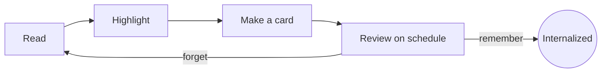

```markdown
# Welcome to Margin

Margin is a quiet, Kindle-style place to **read Markdown** — especially the long, dense answers that LLMs produce — and to actually *keep* what you read. This guide is itself a Markdown file, so it doubles as a tour.

> [!TIP]
> Turn pages with **→ / ←**, **Space**, the mouse wheel, a swipe, or by clicking the right or left side of the page. Press **?** at any time to see every shortcut.

## 1. Reading comfortably

Open the **Aa** menu (top right, or press `A`) to change:

- **Typeface** — Literata (a book face), Atkinson Hyperlegible (designed for legibility), or your system fonts.
- **Size, line spacing and margins** — the line length is kept to a comfortable measure, so text never runs edge to edge on a wide monitor.
- **Theme** — Paper, Sepia, Dusk or Night.
- **Layout** — *Pages* (one or two columns, like a book) or *Scroll* (one long column).

The footer shows where you are. Click the middle of it to cycle between *page*, *time left in chapter* and *time left in book*. Margin learns your reading speed as you go, so the estimates get better over time.

## 2. Built for LLM output

LLM answers lean on a handful of Markdown habits. Margin renders all of them:

| Feature | How it is written | What you see |
|---|---|---|
| Math | `$E = mc^2$`, `\( a^2 + b^2 \)`, `$$ … $$`, `\[ … \]` | Typeset equations |
| Code | Fenced blocks with a language | Highlighted code with a **Copy** button |
| Diagrams | ```` ```mermaid ```` blocks | Rendered flowcharts and sequences |
| Callouts | `> [!NOTE]`, `> [!WARNING]` … | Coloured asides |
| Tables | Pipe tables | Scrollable, zebra-striped tables |
| Footnotes | `[^1]` | Linked notes at the end[^1] |

It also tidies common artefacts: an answer wrapped entirely in a ```` ```markdown ```` fence (like this file) is unwrapped, and stray citation markers such as 【4:0†source】 are hidden.

### Math, both styles

Inline math works with dollars, $\sigma(x) = \frac{1}{1 + e^{-x}}$, and with brackets, \( \nabla_\theta J(\theta) \). Display math too:

$$
\text{Attention}(Q, K, V) = \operatorname{softmax}\!\left(\frac{QK^\top}{\sqrt{d_k}}\right)V
$$

\[
\mathbb{E}[X] = \sum_{i} x_i \, p(x_i)
\]

### Code

```python
def spaced_repetition(interval_days: float, ease: float, grade: int) -> float:
    """Return the next review interval (a tiny SM-2 flavour)."""
    if grade == 0:          # forgot
        return 0.0
    return max(1.0, interval_days * ease * (0.8 if grade == 1 else 1.0))
```

### Diagrams



## 3. Internalizing what you read

Reading once is rarely enough. Margin gives you a few light-weight tools grounded in learning research:

- **Highlights** — Select any text and pick a colour. Add a note to say *why* it matters to you.
- **Retrieval practice** — Recalling an idea from memory strengthens it far more than re-reading it. That is why Margin puts a short checkpoint at the end of each section.
- **Spaced repetition** — Reviewing a card just before you would forget it, at growing intervals, makes memories durable with little total effort.
- **Elaboration** — Explaining an idea in your own words, and connecting it to what you already know, deepens understanding.
- **Key concepts** — Margin finds the terms an LLM put in **bold** and pairs each with its definition, so you can browse them or quiz yourself.

> [!NOTE]
> Everything you create — highlights, notes, summaries, cards and reading progress — is stored as plain JSON on your own computer. Nothing leaves your machine.

### Making cards

Select a sentence and choose **Card**. Margin turns your selection into a *cloze* card — the sentence with your selection blanked out — which you can edit before saving. Open **Review** from the top bar (or the library) to study the cards that are due today, rating each one *Again*, *Hard*, *Good* or *Easy*.

### Quiz yourself

Open the **Concepts** panel (press `K`) and choose **Quiz me** for a quick multiple-choice round built from this document's defined terms.

### Moving between topics and chapters

References such as "Section 3.4", "Example 3.2" or "Chapter 4" become links, and so do tables of contents and links an LLM writes. If a folder holds several chapters (`01-…md`, `02-…md`), references to another chapter open that file, **Contents** lists every chapter with its sections, and each chapter ends with *Previous / Next* links. After any jump, a **Back to page N** button takes you back to where you were.

### Textbook chapters

Margin also reads practice-book chapters: worked examples whose solutions you reveal when ready, quick checks and food-for-thought questions inside the text, and end-of-chapter problems — short answer, multiple choice and numerical exercises — checked against an answer key, with your progress tracked per section. Open **Sample chapter - Motion in a Straight Line** from the library to see it.

### Exporting to PDF

Press `P` (or the printer icon) to save the document as a PDF — laid out like a book, with page numbers, an optional cover and contents, your highlights and notes, and a glossary. Choose *My notebook* instead to get just your summaries, highlights, notes and flashcards for revision. In the print window that opens, pick *Save as PDF*.

## 4. Your library

Start Margin with a folder — `margin ~/notes` on Linux or `margin.exe C:\Notes` on Windows — and every Markdown file inside becomes a book on your shelf. You can also:

1. Click **Add folder** in the library and type a path.
2. Drag `.md` files onto the browser window; they are copied to the *Imported* shelf.
3. Keep a file open while an LLM or your editor rewrites it — Margin reloads it automatically and keeps your place.

> [!WARNING]
> If you start Margin with `-host 0.0.0.0` to read on a tablet, anyone on your network can open your library. Only do this on networks you trust.

## 5. Keyboard shortcuts

| Key | Action |
|---|---|
| `→` `Space` `PgDn` | Next page |
| `←` `Shift+Space` `PgUp` | Previous page |
| `Home` / `End` | Start / end of book |
| `T` | Contents (all chapters in the folder) |
| `[` / `]` | Previous / next chapter |
| `Alt+←` or `Backspace` | Back to where you were |
| `/` | Search in book |
| `N` | Notebook (highlights, notes, cards) |
| `K` | Key concepts |
| `R` | Review due cards |
| `B` | Bookmark this page |
| `A` | Reading settings |
| `P` or `Ctrl+P` | Export PDF |
| `F` | Full screen |
| `Esc` | Close panel / back to library |

Happy reading.

[^1]: Footnotes like this one are collected at the end of the document and linked both ways.
```
