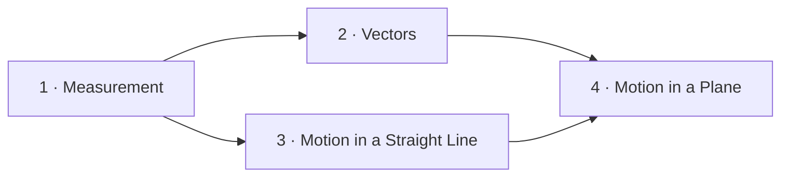

# Courses for Margin — a subject built from basic building blocks

A course is a folder of Markdown files that Margin reads as one book:

```
mechanics/
  00-course-map.md                ← the plan: who it's for, the building blocks, the chapters
  01-measurement.md               ← chapters, in dependency order
  02-vectors.md
  03-motion-in-a-straight-line.md
  03a-review-chapters-1-3.md      ← mixed review after every 3–4 chapters
  04-motion-in-a-plane.md
  …
```

Margin lists the chapters in its Contents, links `Chapter 4` / `Section 4.2` references between files, and shows *Previous / Next chapter* at the end of each one. The goal of this skill is that **every chapter can be learned using only the chapters before it** — no gaps, no forward jumps, no term used before it is taught.

Read `references/teaching-method.md` for the teaching method and its sources. Chapters themselves follow the **margin-textbook** skill (practice chapters) or the **margin-markdown** skill (reading-only chapters); if those skills are not available, follow the rules summarised in §5.

## 1. Understand the learner and the goal

Settle three things before planning; ask the user briefly if you can, otherwise choose sensible defaults and state them in the course map:

1. **Goal** — what the learner should be able to *do* at the end (solve projectile problems, read a balance sheet, write a parser…).
2. **Starting point** — what they already know. This becomes *Assumed knowledge*. Anything not on that list must be taught.
3. **Style** — practice chapters (examples, questions, answer key → margin-textbook) or reading chapters (explainers → margin-markdown). Default: practice chapters for maths, science and technical skills.

## 2. Map the building blocks (plan in a scratch file or in your reasoning)

1. **Inventory**: list every concept the goal needs — typically 20–80 — one sentence each. Concepts are small: "displacement", not "kinematics".
2. **Dependencies**: for each concept, list the concepts it directly needs.
3. **Order**: arrange them so every concept comes after everything it needs (a topological order). If two concepts need each other, split one into smaller parts until the cycle disappears.
4. **Ground check**: the first concepts must depend only on the assumed knowledge. Walk the list from the top and ask, for each one, "could the learner understand this with only what came before?"
5. **Glossary plan**: note the chapter and section where each term will be defined. Each term is defined exactly once in the whole course; later chapters link back to it instead of redefining it.

## 3. Group the blocks into chapters

- 4–10 related concepts per chapter, one coherent theme, roughly equal effort; usually 5–15 chapters per course.
- **A chapter depends only on earlier chapters.** If chapter 4 needs a concept planned for chapter 6, move that concept earlier.
- Give each chapter a motivating, concrete problem it will equip the learner to solve.
- After every 3–4 chapters, plan a **review** file (`03a-review-chapters-1-3.md`) with mixed problems from those chapters. Mixing topics (interleaving) and returning to them later (spacing) make knowledge last.
- Name files `NN-short-title.md` with two-digit numbers, starting at `01`. The number is what makes `Chapter N` references link across files.

## 4. Write the course map — `00-course-map.md`

Use this structure (a full example is in `references/course-map-example.md`):

````markdown
# Mechanics from First Principles — Course Map

One short paragraph: what the course covers and what the learner will be able to do at the end.

## Who This Is For

- *Assumed knowledge*: arithmetic, solving linear equations, reading line graphs.
- *Taught in this course*: everything else — including the trigonometry needed in Chapter 2.

## The Building Blocks



## Chapters

| Chapter | Builds on | New building blocks | You will be able to |
|---|---|---|---|
| Chapter 1 · Measurement | — | units, dimensions, significant figures | check an equation by its units |
| Chapter 2 · Vectors | Chapter 1 | scalar, vector, components | add displacements and forces |

## Reviews

- *Review A* — after Chapter 3: mixed problems from Chapters 1–3.

## How to Study

1. Work through the chapters in order; start each one with its Building Blocks recap.
2. Answer every quick check before revealing the answer, and mark it honestly.
3. Do the end-of-chapter practice a day later, and review the flashcards Margin schedules.
4. Before a new chapter, reread the Key Takeaways of the chapters it builds on.
````

Rules for the map:
- The Mermaid diagram shows chapters (not every concept), at most about 12 nodes; arrows point from prerequisite to dependent chapter.
- Write chapter references as `Chapter N · Title` so they become links once the chapter files exist.
- No bold key terms in the map — terms are defined in the chapters.

## 5. Write the chapters, in order

Write chapter 1 first, then 2, and so on — never out of order — so every back-reference points at something that already exists.

For each chapter:
1. Start from its plan: the concepts, their order, the opening problem, the prerequisites.
2. Write it with **margin-textbook** (or **margin-markdown**). Its `## Building Blocks` section lists the prerequisites from earlier chapters, each with a one-line refresher and a `Chapter N` / `Section N.k` reference to where it was taught.
3. Teach each concept with the block order: why → mechanism before name → `- **Term**: definition` → formal statement → example and non-example → link back → quick check.
4. **Never redefine** a term defined in an earlier chapter. Link to it: *"displacement (Section 3.1)"*. **Never use** a term that has not been defined yet in this chapter or an earlier one.
5. Include 1–3 problems that combine this chapter with earlier ones, and say which chapters they use.
6. In *Key Takeaways*, point forward to the chapter that uses these ideas next.

Review files: `# Review A · Chapters 1–3`, a short `## What This Review Covers`, then the practice sets and `## Answer Key` exactly as in margin-textbook, with problems mixing all the chapters and each answer naming the section that teaches it.

## 6. Keep the plan and the chapters in step

- If writing a chapter shows that a concept is missing or in the wrong place, update the course map (and the plan) before continuing.
- Long courses: write the course map and chapter 1, then continue chapter by chapter in later turns. Keep the scratch plan (concepts, order, glossary locations) so later chapters stay consistent.
- If `scripts/check_margin.py` is available, run it on the whole folder: `python scripts/check_margin.py mechanics/*.md`. It flags references to chapters or sections that don't exist yet, terms used before they are defined, and broken links.

## 7. Final checklist

- [ ] Goal, assumed knowledge and style settled; stated in the course map
- [ ] Concepts small, listed, in dependency order; the first ones need only the assumed knowledge
- [ ] Chapters of 4–10 concepts, each depending only on earlier chapters; reviews every 3–4 chapters
- [ ] `00-course-map.md` with Who This Is For, The Building Blocks (diagram), Chapters (table), Reviews, How to Study
- [ ] Chapters written in order as `NN-title.md`, each with Building Blocks that link back, no redefinitions, no undefined terms
- [ ] Checker run on the folder; every reference resolves
