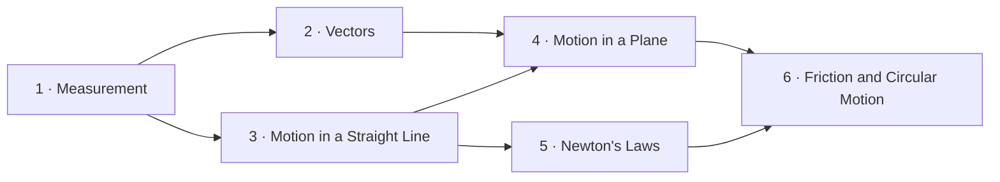

# Mechanics from First Principles — Course Map

This course takes you from measuring a length to predicting how objects move and why. By the end you will be able to solve problems about motion in a line and in a plane, and explain motion with Newton's laws.

## Who This Is For

- *Assumed knowledge*: arithmetic, fractions and decimals, solving a linear equation such as $3x + 2 = 11$, and reading a value from a line graph.
- *Taught in this course*: everything else, including squares and square roots in Chapter 1 and the trigonometry needed for components in Chapter 2.
- *Style*: practice chapters with worked examples, quick checks, end-of-chapter problems and an answer key.

## The Building Blocks

## Chapters

| Chapter | Builds on | New building blocks | You will be able to |
|---|---|---|---|
| Chapter 1 · Measurement | — | units, dimensions, significant figures, squares and roots | check an equation by its units and report a measurement honestly |
| Chapter 2 · Vectors | Chapter 1 | scalar, vector, triangle rule, components | add displacements and forces |
| Chapter 3 · Motion in a Straight Line | Chapter 1 | displacement, velocity, acceleration, equations of motion, free fall | predict where and how fast a body moves along a line |
| Chapter 4 · Motion in a Plane | Chapters 2 and 3 | relative velocity, projectile motion | find the range and height of a projectile |
| Chapter 5 · Newton's Laws | Chapter 3 | force, mass, inertia, the three laws, free-body diagrams | explain and calculate the forces behind a motion |
| Chapter 6 · Friction and Circular Motion | Chapters 4 and 5 | static and kinetic friction, centripetal acceleration | analyse a car taking a curve without skidding |

## Reviews

- *Review A* — after Chapter 3: mixed problems from Chapters 1–3 (`03a-review-chapters-1-3.md`).
- *Review B* — after Chapter 6: mixed problems from the whole course (`06a-review-chapters-1-6.md`).

## How to Study

1. Work through the chapters in order; start each one with its Building Blocks recap.
2. Answer every quick check before revealing the answer, and mark it honestly.
3. Do the end-of-chapter practice a day later, and review the flashcards Margin schedules for you.
4. Before a new chapter, reread the Key Takeaways of the chapters it builds on.
5. If a review problem stumps you, its answer names the section to reread — go back there before moving on.
